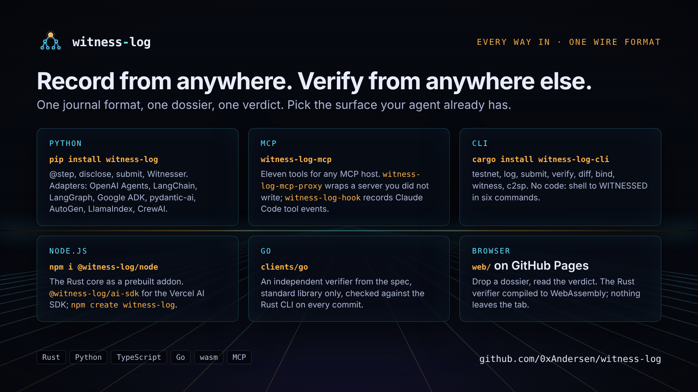
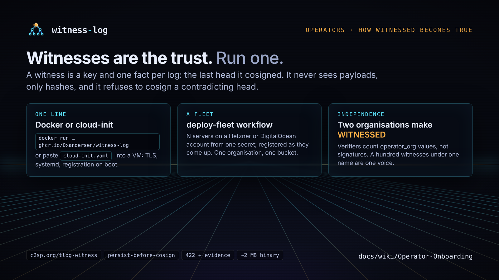

<p align="center">
  
</p>

<h1 align="center">witness-log</h1>

<p align="center"><b>Witnessed, not trusted: a verifiable audit trail for autonomous agents.</b></p>

<p align="center">
<a href="https://github.com/0xAndersen/witness-log/actions/workflows/ci.yml"></a>
<a href="https://github.com/0xAndersen/witness-log/releases/latest"></a>
<a href="https://pypi.org/project/witness-log/"></a>
<a href="https://crates.io/crates/witness-log-cli"></a>
<a href="LICENSE"></a>
<a href="spec/SPEC.md"></a>
</p>

<p align="center">
  
</p>

Every tool call an agent makes becomes a leaf in an RFC 6962 Merkle log signed by the agent's own key.
Witnesses run by other organisations cosign the head and refuse to ever cosign a contradicting one. Anyone
verifies the whole record offline with one command and gets one of five verdicts as an exit code. Any single
entry can be erased for a privacy request without breaking a proof.

```sh
pip install witness-log               # Python, the MCP server and proxy, framework adapters
cargo install witness-log-cli         # the CLI; prebuilt binaries on the Releases page
witness-log demo --tamper             # the GIF above, live: a forgery with flawless cryptography, caught
```

**Docs:** the [wiki](https://github.com/0xAndersen/witness-log/wiki) — quickstarts for
[Python](docs/wiki/Quickstart-Python.md), [CLI](docs/wiki/Quickstart-CLI.md), [Rust](docs/wiki/Quickstart-Rust.md),
[TypeScript](docs/wiki/Quickstart-TypeScript.md) and [Go](docs/wiki/Quickstart-Go.md); [MCP](docs/wiki/MCP-Integration.md);
[framework guides](docs/wiki/Framework-Guides.md); [tutorials](docs/wiki/Tutorial-Audit-a-Payments-Agent.md);
[architecture](docs/wiki/Architecture.md); [threat model](docs/wiki/Threat-Model.md); [glossary](docs/wiki/Glossary.md).

---

## How it works

<p align="center"></p>

An audit trail has to answer two questions: *what happened?* and *can you prove it to someone who does not trust
you?* A log in a database the operator controls answers the first and makes the second unanswerable. witness-log
is built so the second question has an answer that survives the operator, the vendor and the agent itself.

### 1 · Record: intent before, result after

<p align="center"></p>

Each tool call is two leaves: an **intent** written before the tool runs and a **result** written after. The tree
stores only `SHA256(bucket_pad(payload) || salt || index)`, with the salt in a sidecar outside the tree, so
payloads never leave your machine and a hash of `"yes"` is unguessable. Cost: tens of microseconds per call.

### 2 · Commit: one signed root for the whole history

<p align="center"></p>

Leaf hashes form an RFC 6962 Merkle tree. A long-lived **identity key** signs a checkpoint over the root; each
process run uses a fresh **session key** the identity vouches for, so a restart is a provable continuation.
Inclusion and consistency proofs show one leaf is present and a newer root extends an older one without rewriting.

### 3 · Witness: other organisations remember your head

<p align="center"></p>

A witness is a key plus one fact per log: the last head it cosigned. The agent posts each checkpoint with a
consistency proof over [`c2sp.org/tlog-witness`](https://c2sp.org/tlog-witness), the protocol Certificate
Transparency witnesses speak. The witness persists before replying, cosigns, and if a log ever presents two roots
for one size, refuses (`422`) and writes evidence anyone can check.

### 4 · Verify: trust comes from the verifier, not the file

<p align="center"></p>

A **dossier** is one JSON file: identity, leaves, checkpoint, bindings, receipts. The verifier brings two inputs
of its own, the identity it expects and the witness directory it trusts, and `WITNESSED` needs cosignatures from
two distinct `operator_org` values in *that* directory. A fabricated dossier with invented auditors tops out at
`UNANCHORED`.

```sh
witness-log verify dossier.json --identity "$AGENT_KEY" --directory trusted.json   # exit 0 = WITNESSED
```

`0` WITNESSED · `11` WITNESSED, but not by a majority of your directory · `10` CONSISTENT-UNWITNESSED ·
`20` UNANCHORED · `30` DIVERGED (valid, but contradicts a head or equivocation proof you supplied) · `40` INVALID
(a check failed) · `2` usage.
No network, no account, verifiable in ten years.

### 5 · Erase: right to be forgotten, every proof intact

<p align="center"></p>

`forget(i)` deletes leaf *i*'s salt and appends a redaction leaf naming the index. Every proof and every witness
cosignature stays valid, the content is unrecoverable, and the erasure is itself on the record. Hash chains cannot
do this.

---

## Where it sits

witness-log is the **transparency layer** under whatever your agents already use for identity, authorization
and payments. Mandate protocols (AP2, x402, verifiable-intent schemes, UCAN) prove a principal *authorized* an
action; none detects the operator later rewriting its record of what the agent did with that authority. Record
the mandate hash as an authorization event, get the head witnessed, and `witness-log bind` proves both parties
committed to the same mandate while `verify` proves neither history moved
([AP2 tutorial](docs/wiki/Tutorial-AP2-Mandates.md), [commerce profiles](docs/wiki/Commerce-Profile.md)).
SCITT standardises transparency receipts; witness-log is the same primitive applied per agent, with erasure and
intent/result semantics added ([SCITT mapping](docs/wiki/SCITT-Mapping.md)).

<p align="center"></p>

The design choices and their reasons: [Design decisions](docs/wiki/Design-Decisions.md). How it compares to
Tessera, immudb, Signet, Microsoft AGT, Agent Receipts and SCITT, each from primary sources:
[Comparison](docs/wiki/Comparison.md). What is proven and what is not: [`THREAT_MODEL.md`](THREAT_MODEL.md).

---

## Use it

<p align="center"></p>

**Python**

<!-- doctest: group=python before="witness-log testnet up --out trusted.json" after="witness-log testnet down" -->
```python
import witness_log
log = witness_log.open("agent.jsonl")

@witness_log.step(log)                       # intent leaf before, result leaf after
def transfer_funds(amount_usd: int) -> dict:
    return {"status": "ok", "tx_id": "tx_7ac31"}

transfer_funds(250)
log.forget(log.append_memory(b"contact: alice@example.com"))   # erase one entry; proofs intact
print(log.submit("trusted.json")["verdict"])                   # one witnessing round
```

`log.disclose(i)` hands an auditor one entry's salt; `Witnesser` witnesses in the background without blocking
the agent; `WITNESS_LOG_IDENTITY_SEED_ENV` seals every journal so the key never touches disk. Adapters:
`pip install "witness-log[openai-agents]"` (also `langchain`, `langgraph`, `google-adk`, `pydantic-ai`,
`autogen`, `llamaindex`, `crewai`), each run against the live framework nightly.
[Quickstart: Python](docs/wiki/Quickstart-Python.md).

**MCP.** `witness-log-mcp` gives any MCP host eleven tools (record, prove, erase, witness, bind);
`witness-log-mcp-proxy --name git -- mcp-server-git` records every tool call of a server you did not write;
`witness-log-hook` records Claude Code tool events. [MCP](docs/wiki/MCP-Integration.md) ·
[proxy](docs/wiki/MCP-Proxy.md) · [hooks](docs/wiki/Hooks.md).

**CLI, no code.** Three local witnesses are enough to see every verdict on one machine:

<!-- doctest: group=cli -->
```sh
witness-log testnet up --out trusted.json
witness-log log init agent.jsonl
witness-log log append agent.jsonl --intent '{"tool":"transfer_funds","amount_usd":250}'
witness-log submit agent.jsonl --directory trusted.json --out dossier.json
witness-log verify dossier.json --directory trusted.json
witness-log testnet down
```

`submit` is fail-closed: a directory majority or exit 20. `witness-log doctor` checks a journal, a directory
or a witness and prints the fix for each problem. Every subcommand and exit code:
[CLI reference](docs/wiki/CLI-Reference.md).

**CI.** `uses: 0xAndersen/witness-log@v0.6.1` verifies a dossier in a GitHub workflow and fails the job unless
it is WITNESSED. [GitHub Action](docs/wiki/GitHub-Action.md).

**Rust.** `witness-log-core` (log, journal, redaction, C2SP encoding) and `witness-log-network` (witnesses,
quorum, dossiers, verdicts). `cargo run -p witness-log-core --example quickstart` is the whole integration in
one file. [Quickstart: Rust](docs/wiki/Quickstart-Rust.md).

**Node.js.** `@witness-log/node` is the Rust core as a prebuilt addon; `@witness-log/ai-sdk` wraps Vercel AI
SDK tools, middleware and telemetry; `npm create witness-log` scaffolds a project.
[Quickstart: TypeScript](docs/wiki/Quickstart-TypeScript.md).

**Go and the browser.** [`clients/go`](clients/go) is an independent verifier written from the spec and checked
against the Rust CLI on every commit; [`web/`](web) verifies a dossier in the browser with nothing installed.
[Quickstart: Go](docs/wiki/Quickstart-Go.md) · [Browser verifier](docs/wiki/Browser-Verifier.md).

---

## Run a witness

<p align="center"></p>

WITNESSED needs two independent organisations in the verifier's directory, so the first two operators to
register unlock it for everyone. One line on any always-on box:

```sh
docker run -d --name witness-log --restart unless-stopped -p 7380:7380 -v witness-log:/state \
  -e WITNESS_ORG="Your Org" ghcr.io/0xandersen/witness-log:latest
```

Or deploy one on your own account with one click, built from source with its state on a persistent
disk: [](https://render.com/deploy?repo=https://github.com/0xAndersen/witness-log)
(or the same from your fork, pinned to a release: [Operator onboarding](docs/wiki/Operator-Onboarding.md#deploy-in-one-click))
or Fly.io ([`deploy/fly`](deploy/fly/README.md)). Then
`curl -fsS https://<your witness>/ | jq .directory_entry` is your registry entry.
Or paste [`deploy/witness/cloud-init.yaml`](deploy/witness/cloud-init.yaml) into a new VM and it comes up with
TLS and registers itself; the `deploy-fleet` workflow does that for N servers from one cloud token. A witness
never sees payloads, only hashes, and a hundred witnesses under one organisation count as one voice.
Three organisations that each run one witness and exchange directory entries reach WITNESSED for each
other's agents without anyone else: [Pilot: three organisations](docs/wiki/Pilot-Three-Organisations.md).
[Operator onboarding](docs/wiki/Operator-Onboarding.md) · [`OPERATORS.md`](deploy/witness/OPERATORS.md) ·
live [status](https://github.com/0xAndersen/witness-log/blob/status/STATUS.md) of every registered witness.

---

## Evidence

Every push runs 346 Rust tests, 216 Python/MCP/registry tests, the TypeScript, Node and Go suites, an overhead
budget, clippy and rustdoc with `-D warnings`, `cargo deny`, the conformance corpus, ten live witnesses through
ten scenarios, 103 scenarios against the released CLI and wheel, and a 200-agent swarm, on Linux, macOS and Windows.

| run | result |
|---|---|
| [100 release scenarios](examples/swarm/reports/v0.3.3-release.md) | 100/100 |
| [1,000 agents, before fixes](examples/swarm/reports/outside-1000-before-fixes.md) | 3 design defects found and fixed |
| [1,000 agents after fixes](examples/swarm/reports/outside-1000.md) | 92,301 operations, 0 failures |
| [3,000 agents, 100 witnesses](examples/swarm/reports/outside-3000.md) | 325,708 operations, 0 failures |
| [100,000 agents, 37 personas, every 0.4.0 surface](examples/swarm/reports/outside-100k.md) | 4,644,419 operations; 5 defects found, fixed in 0.4.1 |
| [100,000 agents against 0.5.0](examples/swarm/reports/outside-100k-0.5.0.md) | 4,631,033 operations, 0 crashes; 3 defects found (GIL held across fsync, proxy export and crash-retry races), fixed in 0.5.0 |
| [100,000 agents against the released 0.5.0](examples/swarm/reports/outside-100k-0.5.0-release.md) | 4,655,983 operations, 0 failures, 0 findings |
| [same-key rewrite](examples/rewrite-attack/run.py) | refused with evidence (`422`), `diff` flags equivocation |
| [agent payments, x402 + AP2](examples/agent-payments/) | both logs bound; a changed amount, a rewritten history and an edited leaf fail (30, 20/30, 40) |

Two outside evaluations ran witness-log and its competitors on the same workloads; every defect they found is
fixed with a regression test. [Testing and evidence](docs/wiki/Testing-and-Evidence.md).

---

## Repository

```
crates/           core, network, cli, python (PyO3), wasm
clients/          node (@witness-log/node), ai-sdk, typescript (@witness-log/client), create-witness-log, go
web/              browser verifier (GitHub Pages)
spec/  corpus/    SPEC.md, dossier schema, 12 encoding vectors and 1 verification vector
docs/             wiki source, rfcs/, assets/, SECURITY-AUDIT-BRIEF.md
integrations/mcp/ MCP server shim and tests
examples/         sample dossier, rewrite-attack/, live-network/, swarm/
deploy/witness/   Dockerfile, compose, systemd, cloud-init, fleet.py, OPERATORS.md, AGENT_OPERATOR.md
deploy/fly/       Fly.io config for one witness (render.yaml at the root is the Render Blueprint)
registry/         the public witness list (CI-validated) and directory builder
```

Pre-1.0 (v0.5.0). Apache-2.0; see `LICENSE` and `NOTICE`. Spec changes go through RFCs in
[`docs/rfcs/`](docs/rfcs) and `GOVERNANCE.md`; vulnerability disclosure in `SECURITY.md`;
[Contributing](docs/wiki/Contributing.md).
