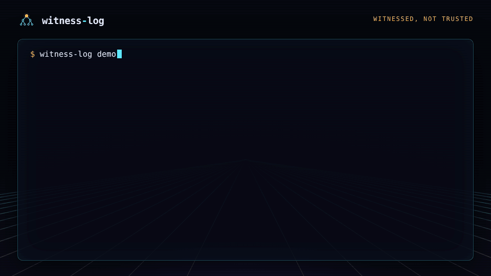
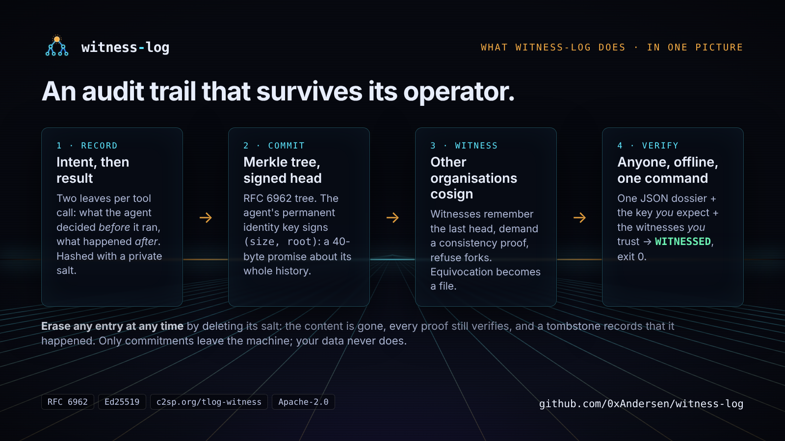
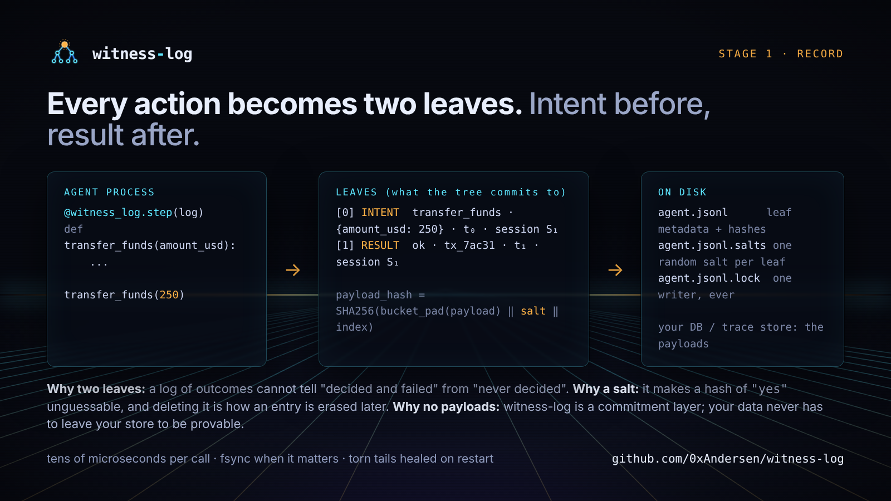
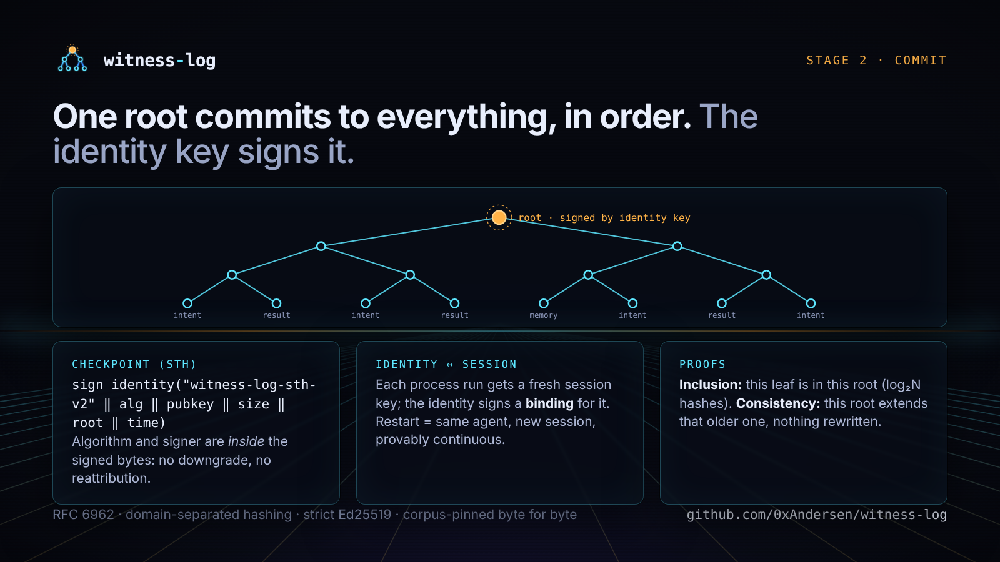
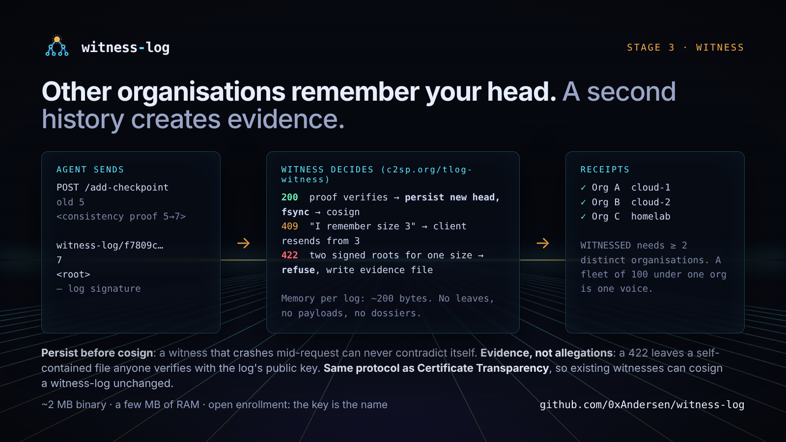
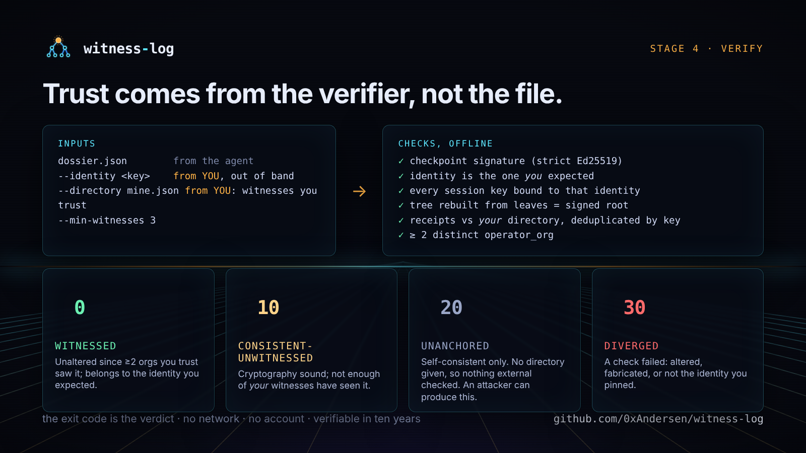
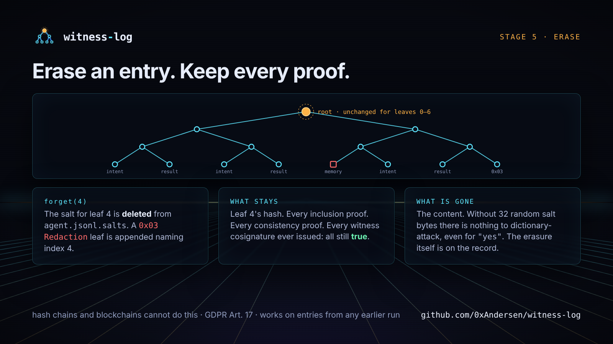
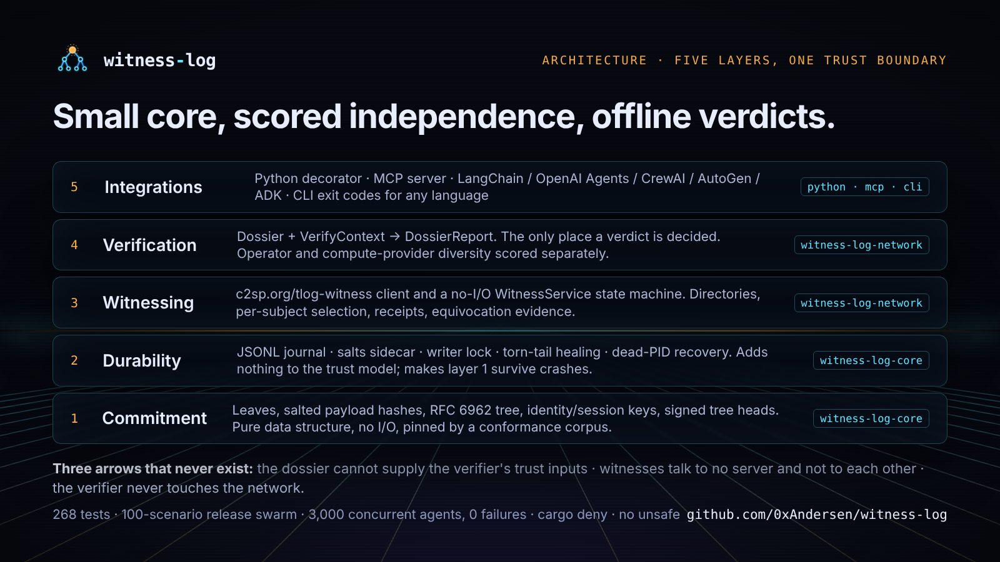

<p align="center">
  
</p>

<h1 align="center">witness-log</h1>

<p align="center"><b>Witnessed, not trusted: a verifiable audit trail for autonomous agents.</b></p>

<p align="center">
<a href="https://github.com/0xAndersen/witness-log/actions/workflows/ci.yml"></a>
<a href="https://github.com/0xAndersen/witness-log/releases/latest"></a>
<a href="LICENSE"></a>
<a href="spec/SPEC.md"></a>
<a href="examples/swarm/reports/outside-3000.md"></a>
</p>

<p align="center">
  
</p>

Every tool call an agent makes becomes a leaf in an RFC 6962 Merkle log
signed by the agent's own key. Independent witnesses, run by other
organisations, cosign the head and refuse to ever cosign a contradicting
one. Anyone can verify the whole record offline with one command and get
one of four verdicts as an exit code. Any single entry can be erased for a
privacy request without breaking a single proof.

```sh
cargo install witness-log-cli      # the CLI (crates.io); prebuilt binaries + SHA256SUMS on the Releases page
pip install witness-log            # Python (PyPI; CPython 3.9+; Linux, macOS, Windows wheels)

witness-log demo                   # the GIF above, live, in your terminal: no files, no network
witness-log demo --tamper          # a forgery with flawless cryptography, caught
```


**Docs:** the [wiki](https://github.com/0xAndersen/witness-log/wiki) (source in [`docs/wiki/`](docs/wiki/Home.md)):
educational [Python](docs/wiki/Quickstart-Python.md) / [Rust](docs/wiki/Quickstart-Rust.md) / [CLI](docs/wiki/Quickstart-CLI.md)
quickstarts, [MCP](docs/wiki/MCP-Integration.md), [framework guides](docs/wiki/Framework-Guides.md)
(LangChain, OpenAI Agents SDK, CrewAI, AutoGen, Google ADK, LlamaIndex, Claude Code), two end-to-end
[tutorials](docs/wiki/Tutorial-Audit-a-Payments-Agent.md), the [architecture](docs/wiki/Architecture.md),
[how a leaf becomes a proof](docs/wiki/How-a-Leaf-Becomes-a-Proof.md), the
[witness protocol on the wire](docs/wiki/Witness-Protocol-Walkthrough.md), [compliance](docs/wiki/Compliance.md),
[threat model](docs/wiki/Threat-Model.md), [troubleshooting](docs/wiki/Troubleshooting.md) and a [glossary](docs/wiki/Glossary.md).

---

## How it works

<p align="center"></p>

An audit trail has to answer two different questions: *what happened?* and
*can you prove it to someone who does not trust you?* Most tooling answers
the first with a log in a database the operator controls, which makes the
second unanswerable. witness-log is built so that the second question has
an answer that survives the operator, the vendor, and the agent itself.

### 1 · Record: intent before, result after

<p align="center"></p>

Each tool call produces two leaves: an **intent** leaf written before the
tool runs (name, arguments, time) and a **result** leaf after (return value
or exception). A log that only records outcomes cannot distinguish "decided
and failed" from "never decided"; two leaves make both provable.

The tree never stores the content. It stores
`payload_hash = SHA256(bucket_pad(payload) || salt || index)` with a
32-byte random salt kept in a sidecar outside the tree. The salt makes a
hash of `"yes"` unguessable, the bucket padding hides exact lengths, and
the index binds content to position. Your payloads stay in your own store;
only commitments ever leave the machine.

```python
import witness_log
log = witness_log.open("agent.jsonl")        # create, or resume the same identity

@witness_log.step(log)                       # every call: an intent leaf, then a result leaf
def call_tool(name: str, **args) -> dict: ...
```

That is the whole integration for a Python loop. Leaves are not individually
signed; each records the session key that wrote it, and the identity-signed
checkpoint over the whole tree is what is load-bearing (a leaf is either in
the signed tree or it is not). Measured cost: **tens of microseconds** per
decorated call (20–115 µs across the machines it has been timed on). The
journal (`agent.jsonl` plus `agent.jsonl.salts`) is append-only, fsyncs on
demand, heals a torn last line after a crash, and refuses a second writer.
By default the identity seed lives in the journal header (mode 0600);
`witness_log.open(path, identity_seed=seed, seal=True)` keeps it out of the
file entirely so the journal holds only the public key and the seed stays in
your KMS or secrets manager.

### 2 · Commit: one signed root for the whole history

<p align="center"></p>

Leaf hashes form an RFC 6962 Merkle tree; the 32-byte root commits to every
leaf and their order. The agent's **identity key** (long-lived, the agent's
name) signs a checkpoint over `(tree_size, root, time)`. Each process run
uses a fresh **session key** that the identity vouches for with a signed
binding, so a restart is a provable continuation rather than a new log,
and a checkpoint stays verifiable after the process that made it is gone.

Inclusion proofs show one leaf is in a root in `log₂N` hashes; consistency
proofs show a newer root extends an older one without rewriting anything.
Algorithm identifier and signer key are *inside* every signed message, not
beside it, which closes algorithm-downgrade and receipt-reattribution
attacks.

### 3 · Witness: other organisations remember your head

<p align="center"></p>

A witness is a key plus one fact per log: *the last head I cosigned*. The
agent POSTs its checkpoint with a consistency proof from that head over the
public [`c2sp.org/tlog-witness`](https://c2sp.org/tlog-witness) protocol,
the same one Certificate Transparency witnesses speak. The witness
verifies the proof (reconstructing **both** roots, per RFC 9162
§2.1.4.2), **persists its new memory to disk before replying**, and
cosigns. If a log ever presents two signed roots for one size, the witness
refuses (`422`) and writes a self-contained evidence file anyone can check
with the log's public key. Equivocation stops being an allegation and
becomes a file.

### 4 · Verify: trust comes from the verifier, not the file

<p align="center"></p>

A **dossier** is one JSON file: identity, leaves, checkpoint, bindings,
receipts. The verifier adds two inputs of its own, obtained out of band:
the identity it *expects* and the witness directory it *trusts*. Receipts
are scored only against that directory, never the dossier's own list, and
`WITNESSED` requires cosignatures from at least two distinct
`operator_org` values. That is why a fabricated dossier with flawless
cryptography and three invented "independent auditors" tops out at
`UNANCHORED`: it cannot sign as a key it does not hold, and it cannot put
its witnesses into *your* directory.

```sh
witness-log verify dossier.json --identity "$AGENT_KEY" --directory trusted.json --min-witnesses 3 || exit 1
```

`0` WITNESSED · `10` CONSISTENT-UNWITNESSED · `20` UNANCHORED · `30` DIVERGED · `2` usage. The exit code is
the verdict; no network, no account, verifiable in ten years.

### 5 · Erase: right to be forgotten, every proof intact

<p align="center"></p>

`log.forget(i)` deletes leaf *i*'s salt from the sidecar and appends a
`0x03` Redaction leaf naming the index. The leaf's hash, every inclusion
and consistency proof, and every witness cosignature ever issued remain
valid; the content is computationally unrecoverable (32 random bytes to
brute-force, even for a one-word payload); and the erasure itself is on
the record. Hash chains and blockchains cannot do this. GDPR Article 17 can
now be honoured without choosing between the regulator and the auditor.

---

## Where it sits

witness-log is the **transparency layer** under whatever your agents already
use for identity, authorization and payments, not a replacement for any of
them. Mandate-based protocols (AP2, Visa/Mastercard verifiable-intent
schemes, x402, UCAN) prove a principal *authorized* an action; none of them
detects the operator later rewriting its own record of what the agent did
with that authority. SCITT (RFC 9943) standardises transparency receipts;
witness-log's leaves, checkpoints and C2SP witnessing are the same shape of
primitive applied per agent, with erasure and intent/result semantics added.
Record the mandate hash as an `AuthorizationEvent` scope (`record_authorization`
over MCP, `append_authorization_event` in Python or Rust), get the head
witnessed, and `witness-log bind` later proves both parties committed to the
same mandate while `verify` proves neither side's history moved. The
[Comparison](docs/wiki/Comparison.md) page covers Tessera, immudb, Signet,
Microsoft AGT and others by property.

## What makes it different

<p align="center"></p>

These are the specific design decisions, each with its reason, that make
witness-log the right shape for an agent audit trail rather than one more
"immutable log". The full discussion is in the wiki's
[Architecture](docs/wiki/Architecture.md) and [Comparison](docs/wiki/Comparison.md) pages.

- **Intent/result semantics are in the data model**, not an integration convention. Eight leaf types (§2), including handoff attestations and authorization events for work that crosses agent boundaries, each with cross-log bindings an auditor can match after the fact.
- **Salted erasure that preserves proofs** (§8): `SHA256(bucket_pad(payload) || salt || index)`, salt outside the tree, tombstone on erase. The property privacy law needs and tamper-evident logs usually cannot offer.
- **Two-tier keys with signed bindings and disclosed custody** (§5): a permanent identity, disposable sessions, and a `custody` field (`self_held`, `kms`, `hsm`, `platform_held`, …) surfaced beside every verdict so a verifier knows whose signature they are looking at.
- **Independence is scored, not assumed** (§7): distinct `operator_org` values, deduplicated by key, with compute-provider diversity reported as a separate axis and project-run witnesses collapsed into one bucket so the project cannot vouch for itself. Many systems count signatures; this one counts organisations.
- **Persist-before-cosign and portable equivocation evidence**: a witness that crashes mid-request can never contradict itself; a log that forks leaves a file.
- **Correct consistency verification**: both roots reconstructed, per RFC 9162. The weaker variant accepts forks at non-power-of-two sizes; we had that bug at ≤0.3.0, found it in a live run, fixed it, and pinned it with an exhaustive test and a corpus vector. The spec now makes the strict algorithm normative.
- **Canonical encoding that cannot collide**: every variable-length field length-prefixed, every optional field with a presence byte, domain-separated leaf and node hashes (§3–§4). Two different leaves never share one hash.
- **Write receipts** (§9.4): a signed "I accepted this hash at size N" that, with later witnessed checkpoints, proves censorship-by-omission, something a plain checkpoint cannot.
- **C2SP interoperability** (§9.3): checkpoints as `tlog-checkpoint` notes with `cosignature/v1`, verified against the specs' own published vectors. The witnesses already running for the Go checksum database and Sigstore could cosign a witness-log unchanged. The hardest problem in transparency is social; speaking the existing protocol inherits an installed base.
- **The verifier never touches the network, and the dossier never supplies trust inputs.** Those two missing arrows are the design.
- **Only the transparency layer.** Attestation, identity and authorization belong to other layers (RATS, WIMSE, OAuth/UCAN); witness-log logs *that* a delegation happened without becoming an authorization system, which is why it composes with whatever an integration already has.
- **A conformance corpus** (`corpus/`, 11 deterministic vectors) and `witness-log conform` so a second implementation proves byte-for-byte agreement instead of looking similar.

**Read [`THREAT_MODEL.md`](THREAT_MODEL.md) before trusting this with anything real.** It states exactly what is proven and what is not, including the biggest current gap: independent witness operators are still being recruited (`GOVERNANCE.md`). "Witnessed" is only ever as strong as the witnesses *you* chose.

---

## Using it

### Python

```python
import witness_log
log = witness_log.open("agent.jsonl")

@witness_log.step(log)
def transfer_funds(amount_usd: int) -> dict:
    return {"status": "ok", "tx_id": "tx_7ac31"}

transfer_funds(250)
log.forget(log.append_memory(b"contact: alice@example.com"))     # erase one entry; proofs intact
dossier = log.to_dossier_json()                                  # hand this to anyone
print(witness_log.verify_dossier_json(dossier, 0.66, log.identity_pubkey_hex()))
```

[Quickstart: Python](docs/wiki/Quickstart-Python.md) explains every line. For agents that speak MCP,
[`integrations/mcp`](integrations/mcp) exposes the same capability as nine tools (provision a chain on boot,
record every step, record handoffs and authorizations between agents, prove any step, erase on request, get
witnessed) for Claude Code, Claude Desktop, Cursor or any MCP host, with no code.

### Rust

```toml
[dependencies]
witness-log-core = "0.3"        # log, Merkle tree, identity, redaction, journal, C2SP encoding
witness-log-network = "0.3"     # witnesses, quorum, dossiers, verification
```

```rust
use witness_log_core::{identity::IdentityKeypair, journal::JournaledLog};
use witness_log_network::{Dossier, VerifyContext};

let mut log = JournaledLog::create("agent.jsonl", IdentityKeypair::generate())?;   // later runs: JournaledLog::resume
log.append_intent(br#"{"tool":"transfer_funds","args":{"amount_usd":250}}"#)?;
log.append_result(br#"{"status":"ok","tx_id":"tx_7ac31"}"#)?;
log.sync()?;

let dossier = Dossier::from_log(log.log(), log.log().checkpoint_self());
assert!(dossier.verify(0.66, &VerifyContext::default()).internally_consistent);
```

`cargo run -p witness-log-core --example quickstart` is the complete integration in one runnable file.
[Quickstart: Rust](docs/wiki/Quickstart-Rust.md) explains the crates, the invariants and why the API has its shape.

### CLI, from any language

| command | what it does |
|---|---|
| `witness-log demo [--tamper]` | the walkthrough in the GIF; no arguments, no files, no network |
| `witness-log verify <dossier> [--identity <hex>] [--directory <dir.json>] [--min-witnesses N] [--json] [--explain]` | offline verification; exit code is the verdict |
| `witness-log diff <a.json> <b.json>` | two copies of one log: honest growth, equivocation, or tampering |
| `witness-log bind <a.json> <b.json>` | two different agents' logs: prove their handoff / authorization leaves commit to the same bytes and scope |
| `witness-log explain [verdict]` | what each verdict proves and does not |
| `witness-log witness init / serve / submit / info / verify-evidence` | run a witness; get a journal cosigned |
| `witness-log c2sp show / verify` | C2SP checkpoint bodies and signed notes |
| `witness-log conform <dir>` | check another implementation against the corpus |

Go, TypeScript and shell integrate by writing the dossier (schema: `spec/dossier.schema.json`), shelling out to
`verify`, and branching on the exit code: [Other languages](docs/wiki/Other-Languages.md).

---

## Run a witness, get witnessed

```sh
witness-log witness init ./w1 --name w1.example.org/witness --org "Example Org" --url https://w1.example.org --compute hetzner
witness-log witness serve ./w1 --listen 127.0.0.1:7380 --open-enrollment       # 1 MB binary, ~10 MB RAM
```

`--open-enrollment` accepts any log whose origin is `witness-log/<its identity key>`: the origin *is* the key, so
there is no registration and nothing to trust on first use. Then, as an agent:

```sh
witness-log witness submit agent.jsonl --directory trusted.json --out dossier.json
witness-log verify dossier.json --identity "$AGENT_KEY" --directory trusted.json      # exit 0 = WITNESSED
```

`submit` handles `409` resyncs and `Retry-After`, and refuses to publish a journal that contradicts what
witnesses already cosigned, so a journal restored from an old backup cannot get your identity recorded as
equivocating by accident.

WITNESSED needs two distinct organisations in *your* directory. A fleet of a hundred witnesses under one
organisation is one voice. [`deploy/witness/`](deploy/witness) has the Dockerfile, compose with TLS, systemd
units, `fleet.py` for N witnesses on one host, `OPERATORS.md` (the backup rule: key and memory are one object)
and [`AGENT_OPERATOR.md`](deploy/witness/AGENT_OPERATOR.md), a playbook a coding agent can execute end to end on
free always-on compute. Registered witnesses live in [`registry/`](registry); verifiers build their directory
from it. The registry starts empty: the first independent operator is the one that makes WITNESSED mean something.

---

## Evidence

Every push runs 268 Rust tests, the Python and MCP suites, clippy and rustdoc with `-D warnings`,
`cargo deny`, the conformance corpus, ten live witnesses through ten scenarios, 100 scenarios against the
*released* CLI and wheel, and a 200-agent swarm, on Linux, macOS and Windows.

| run | result |
|---|---|
| [100 release scenarios against v0.3.3](examples/swarm/reports/v0.3.3-release.md) | 100/100 |
| [1,000 concurrent agents, 18 personas, before fixes](examples/swarm/reports/outside-1000-before-fixes.md) | 356 rate-limit stalls, 3 honest logs mis-flagged → three design defects found |
| [1,000 agents after fixes](examples/swarm/reports/outside-1000.md) | 92,301 operations, 0 failures |
| [3,000 agents, 100 witnesses](examples/swarm/reports/outside-3000.md) | 325,708 operations, 137,462 cosignings, 0 failures, 100/100 witnesses up |

The defects the first large run found (fraction-only quorum, every agent choosing the same eight witnesses,
clients ignoring `Retry-After`) are fixed in 0.3.3 and the before/after reports are committed. An independent
three-persona evaluation of 0.3.3 (agent developer, transparency-log engineer, agent-commerce lead; competitors
run on the same tasks) confirmed every core claim, measured 20–27 µs per call, and found six defects, all fixed
in 0.3.4: a verifier hang on absurd tree sizes, anchor proofs not bound to their hash, split views passing a
sub-majority gate silently, `submit` failing on bare paths, cross-agent leaves being Rust-only, and the identity
seed always on disk. The one test that separated witness-log from every competitor it was run against: when the
operator rewrote the whole history with its own key, the others accepted it; the witnesses refused (422) and
produced proof. `examples/swarm/`
reproduces all of it; [Testing and evidence](docs/wiki/Testing-and-Evidence.md) explains what each layer checks.

---

## Repository layout

```
witness-log/
├── crates/
│   ├── witness-log-core/      # leaves, Merkle tree, identity, redaction, journal, STH, C2SP encoding
│   ├── witness-log-network/   # witnesses, directories, selection, receipts, quorum, dossiers, verdicts
│   ├── witness-log-cli/       # `witness-log`: demo, verify, diff, explain, witness, c2sp, conform
│   └── witness-log-python/    # PyO3 bindings: pip install witness-log
├── spec/                 # SPEC.md (normative wire format) and dossier.schema.json
├── corpus/               # 11 deterministic conformance vectors
├── docs/wiki/            # the wiki source (auto-published); docs/assets/ holds the graphics above
├── brand/                # logo mark, wordmark, palette
├── integrations/mcp/     # MCP server: the audit trail as tools for any MCP-capable agent
├── examples/             # sample dossier, verify_demo.py, live-network/ (10 witnesses), swarm/ (100 scenarios, 3,000 agents)
├── deploy/witness/       # Dockerfile, compose, systemd, fleet.py, OPERATORS.md, AGENT_OPERATOR.md
├── registry/             # the public witness list (PR-registered, CI-validated) and directory builder
├── fuzz/                 # cargo-fuzz targets
├── THREAT_MODEL.md       # what this proves, what it doesn't
├── GOVERNANCE.md         # federation model, witness recruitment, transition plan
├── SECURITY.md           # vulnerability disclosure
└── CONTRIBUTING.md       # conformance-gate workflow for spec changes
```

## Status

Pre-1.0 (v0.3.5). Core, network, CLI, Python bindings and the MCP server are implemented, tested and
released; the wire format is specified and corpus-pinned. Independent witness operators are being
recruited: see `GOVERNANCE.md` and `deploy/witness/AGENT_OPERATOR.md`.

## License

Apache-2.0; see `LICENSE` and `NOTICE`. Releases through 0.3.4 were AGPL-3.0; the project relicensed so the
client library can be imported into any agent, including inside organisations whose legal review does not admit
copyleft in-process. What keeps the infrastructure federated is the protocol, not the license: the wire format
is specified with a conformance corpus, the witness protocol is the public `c2sp.org/tlog-witness`, and anyone
can run a witness or a verifier. The name is not granted with the code (see `NOTICE`).

## Contributing

Spec changes go through a public RFC process (`GOVERNANCE.md`). Code changes touching §2–§9 of
`spec/SPEC.md` include or update conformance vectors. See [Contributing](docs/wiki/Contributing.md).
